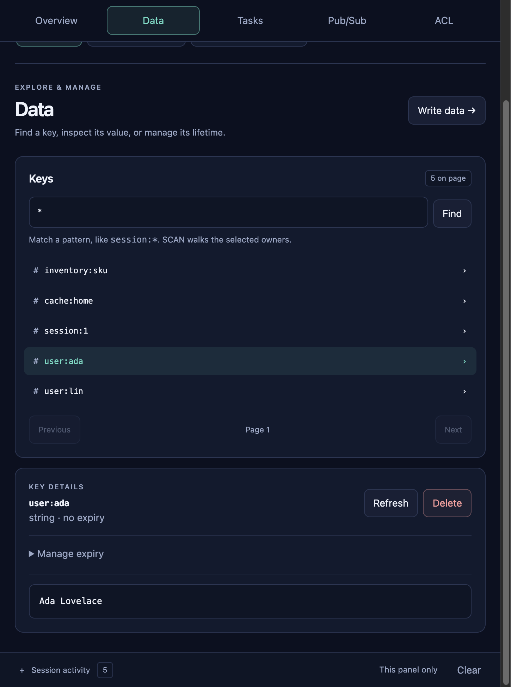
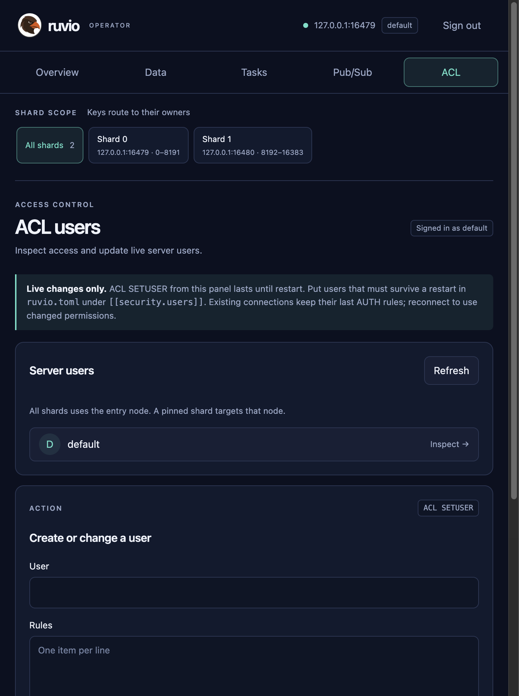

# Ruvio

[](LICENSE)
[](clients/LICENSE)
[](https://github.com/salihcantekin/ruvio/actions/workflows/pr-gate.yml)
[](https://hub.docker.com/r/salihcantekin/ruvio)
[](https://crates.io/crates/ruvio-client)
[](https://www.nuget.org/packages/Ruvio.Client)

Ruvio is the process you run instead of a cache plus a lock service, a conditional write, a change feed, and a delay queue. It speaks RESP. `redis-cli` and existing RESP clients connect. The shard that owns a key parses, records, applies, and replies. The hot path does not take a lock and does not hop to another thread.

On an Apple M4 Pro, evented, memory durability, one shard, 50 clients, pipeline 16, 64-byte values, fixed key, one invocation per command, median of 3 rounds (2026-10-07): about 2.61M SET/s, 2.74M GET/s, and 2.88M INCR/s. Samples and flags are on the [performance page](https://salihcantekin.github.io/ruvio/testing-performance.html). A feature allocates only when a key uses it. Twenty thousand leases added about 3.6 MB. Twenty thousand versioned 64-byte strings added about 7.2 MB, body included.

Durability is named at startup: `memory`, `snapshot`, `everysec`, or `always`. A write is checked, appended, then applied. If the log cannot take the record, the key stays as it was and later writes return `MISCONF`.

The command list that CI checks is [docs/compatibility-matrix.json](docs/compatibility-matrix.json).

## One process, the jobs beside the cache

These commands run on the shard that owns the key. A key that never uses them stores nothing extra. `GET`, `SET`, and `INCR` do not consult them.

| Command | What it replaces a second system for |
| --- | --- |
| `LEASE` / `RELEASE` | A fencing token for one key. The shard is the holder. Expiry and `RELEASE` keep the token, so the next grant continues the sequence. The grant is a WAL record. `GET` of a lease is `WRONGTYPE`. |
| `SEMAPHORE` / `RELEASE` | At most N holders at once, each with its own TTL. A crashed holder frees its slot when its TTL passes. The first holder stays in the object; each further holder is 16 bytes. The key goes away with the last one. |
| `INCRBY ... MAX` | A counter that never passes a capacity. A refused call returns nil and changes nothing, so no compensating `DECR`. |
| `SETV` | A conditional string write. The call succeeds only when the caller still has the current version, so two clients cannot both turn 12 into 11. The version exists only on keys written with `SETV`. |
| `CHANGES` | `CHANGES START` arms an in-memory feed of later `SET`, `SETV`, `LEASE`, and `RELEASE` notes on that shard. Nothing is recorded before `START`. The feed is not the WAL, and it is empty after restart. |
| `XADD DELAY` | The stream entry is stored now. `XREADGROUP` skips it until the delay passes. `XREAD` can still see it. The hold is a WAL record and a snapshot trailer, and it is written only when a delay is set. |

`DEL` of a lease starts the next token at 1. `SET` replaces a versioned string with a plain string. `INCR` does not accept a versioned string.

**Site:** [salihcantekin.github.io/ruvio](https://salihcantekin.github.io/ruvio/) · [Packages](https://salihcantekin.github.io/ruvio/packages.html) · [How it runs](https://salihcantekin.github.io/ruvio/compare.html) · [Operator UI](https://salihcantekin.github.io/ruvio/ui.html) · [Start](https://salihcantekin.github.io/ruvio/start.html)

Test coverage, recorded results, and open production evidence gates:
[Testing and evidence](https://salihcantekin.github.io/ruvio/testing.html) ·
[Contributor test guide](docs/TESTING.md).

## Start the server

A default process listens on `127.0.0.1:6379`.

```bash
docker pull salihcantekin/ruvio:linux
docker run --rm -p 6379:6379 \
  -e RUVIO_REQUIREPASS=change-me \
  -v ruvio-data:/data \
  salihcantekin/ruvio:linux

redis-cli -h 127.0.0.1 -p 6379 -a change-me PING
```

`linux` and `latest` are the same Linux image, as is each version tag, built for linux/amd64. On an arm64 host such as Apple Silicon, Docker runs it under emulation; use a prebuilt binary below for a native arm64 server. The image default durability is `memory`. A persistent deploy sets `RUVIO_DURABILITY` and keeps the volume.

Without Docker, download a prebuilt binary from [GitHub Releases](https://github.com/salihcantekin/ruvio/releases/latest). Each archive holds `ruvio` (the server), `ruvio-ctl` (backup, restore and checks), `ruvio.example.toml`, the README and the license, for Linux x64 and arm64, macOS arm64 and Windows x64. `SHA256SUMS` lists the checksums.

```bash
# Linux x64; swap the platform for linux-arm64 or macos-arm64
v=0.3.2
curl -LO https://github.com/salihcantekin/ruvio/releases/download/ruvio-$v/ruvio-$v-linux-x64.tar.gz
tar xzf ruvio-$v-linux-x64.tar.gz
cd ruvio-$v-linux-x64
./ruvio --requirepass change-me --data-dir ./data
```

On Windows, unzip `ruvio-<version>-windows-x64.zip` and run `ruvio.exe`. On macOS, a binary downloaded by a browser is quarantined; `xattr -d com.apple.quarantine ruvio ruvio-ctl` clears it (downloads with `curl` are not quarantined). `ruvio --help` lists every flag.

From a checkout:

```bash
cargo run --release --bin ruvio
redis-cli -h 127.0.0.1 -p 6379 PING
```

The server is installed from the Docker image, a release binary, or built from this checkout; it is not published as a crate.

Settings merge in this order: built-in defaults, `ruvio.toml` (template: [`ruvio.example.toml`](ruvio.example.toml)), `RUVIO_*` environment variables, then CLI flags. The file is read once, at process start. [Configuration](https://salihcantekin.github.io/ruvio/configuration.html).

## Open the operator UI

[salihcantekin/ruvio-ui](https://hub.docker.com/r/salihcantekin/ruvio-ui) is a browser for one running server. `RUVIO_UI_TARGET_HOST` and `RUVIO_UI_TARGET_PORT` are that Ruvio process, the same address `redis-cli` uses. A default server is `127.0.0.1:6379`. Port `8080` is only the UI.

```bash
docker pull salihcantekin/ruvio-ui:linux
docker run --rm -p 8080:8080 \
  -e RUVIO_UI_TARGET_HOST=127.0.0.1 \
  -e RUVIO_UI_TARGET_PORT=6379 \
  salihcantekin/ruvio-ui:linux
```

Open http://127.0.0.1:8080. Sign-in is the server ACL user. An empty user and password connect as `default`. If the server was started with `RUVIO_REQUIREPASS`, type that password on the sign-in screen, or set `RUVIO_UI_TARGET_PASSWORD` so the field is filled in. Tags `linux` and `latest` are the same image.



All shards lists every key. One shard pins Data, the command screens, and Pub/Sub to that node. Users are `ACL` identities: `default` always exists, extra users that survive a restart live in `ruvio.toml`, and `ACL SETUSER` lasts until the next start.



Install notes: [Operator UI](https://salihcantekin.github.io/ruvio/ui.html).

## Talk to it from an application

First-party clients speak RESP2, do not send `CLIENT SETINFO`, and learn `CLUSTER SLOTS` from one seed address.

```bash
cargo add ruvio-client
```

```rust
use ruvio_client::Client;

let mut db = Client::connect("127.0.0.1", 6379)?;
db.set("session:ada", "hello")?;
let value = db.get_string("session:ada")?;
db.incr("visits")?;
```

```bash
dotnet add package Ruvio.Client --version 0.3.1
```

```csharp
using Ruvio.Client;

await using var db = await RuvioClient.ConnectAsync("127.0.0.1", 6379);
await db.SetAsync("session:ada", "hello");
string? value = await db.GetStringAsync("session:ada");
```

`Ruvio.Client.AspNetCore` registers the same client in a .NET host. Client guides: [Clients](https://salihcantekin.github.io/ruvio/examples.html).

The [.NET integration packages](integrations/dotnet/README.md) provide an
`IDistributedCache` provider, ASP.NET Core output caching and Data Protection
key-ring storage, plus opt-in rate limiting and HTTP idempotency.
They are separate packages; existing server commands and applications
that do not enable them incur no new per-key feature state.

[Native `IDEM`](docs/IDEM.md) adds atomic reservation, ownership
checks, fingerprint conflicts and binary result replay for any RESP client.
The ASP.NET Core idempotency package uses this command, not Lua. `ONCE` remains
the simpler TTL marker. Retention and durability bound deduplication; external
side effects still require their own transaction/idempotency mechanism.

## Packages

Releases are cut from `main` by hand ([release workflow](.github/workflows/release.yml)). Counts come live from the registries. All clients are in [`clients/`](clients/README.md). The Go module is released by git tag (`clients/go/vX.Y.Z`) and fetched through the Go module proxy.

| Package | What it is | Version | Downloads |
| --- | --- | --- | --- |
| [ruvio-client](https://crates.io/crates/ruvio-client) | Rust SDK |  |  |
| [Ruvio.Client](https://www.nuget.org/packages/Ruvio.Client) | C# SDK |  |  |
| [Ruvio.Client.AspNetCore](https://www.nuget.org/packages/Ruvio.Client.AspNetCore) | ASP.NET Core registration and health checks |  |  |
| [Ruvio.Extensions.Caching](https://www.nuget.org/packages/Ruvio.Extensions.Caching) | `IDistributedCache` provider |  |  |
| [Ruvio.AspNetCore.OutputCaching](https://www.nuget.org/packages/Ruvio.AspNetCore.OutputCaching) | Output-cache store with tag invalidation |  |  |
| [Ruvio.AspNetCore.DataProtection](https://www.nuget.org/packages/Ruvio.AspNetCore.DataProtection) | Data Protection key-ring storage |  |  |
| [Ruvio.AspNetCore.RateLimiting](https://www.nuget.org/packages/Ruvio.AspNetCore.RateLimiting) | Distributed rate limiting |  |  |
| [Ruvio.AspNetCore.Idempotency](https://www.nuget.org/packages/Ruvio.AspNetCore.Idempotency) | HTTP idempotency |  |  |
| [Ruvio.AspNetCore.DistributedLock](https://www.nuget.org/packages/Ruvio.AspNetCore.DistributedLock) | Distributed locks and `[RuvioLock]` |  |  |
| [ruvio-client (npm)](https://www.npmjs.com/package/ruvio-client) | Node.js SDK |  |  |
| [ruvio-client (PyPI)](https://pypi.org/project/ruvio-client/) | Python SDK |  |  |
| [io.github.salihcantekin:ruvio-client](https://central.sonatype.com/artifact/io.github.salihcantekin/ruvio-client) | Java SDK |  | |
| [github.com/salihcantekin/ruvio/clients/go](https://pkg.go.dev/github.com/salihcantekin/ruvio/clients/go) | Go SDK | `clients/go/v0.1.0` | |
| [Server binaries](https://github.com/salihcantekin/ruvio/releases/latest) | `ruvio` and `ruvio-ctl` for Linux, macOS, Windows |  |  |
| [salihcantekin/ruvio](https://hub.docker.com/r/salihcantekin/ruvio) | Server image (linux/amd64) |  |  |
| [salihcantekin/ruvio-ui](https://hub.docker.com/r/salihcantekin/ruvio-ui) | Operator UI image |  |  |

Live install lines and download counts: [Packages](https://salihcantekin.github.io/ruvio/packages.html).

## Compared with Redis, Dragonfly, and Garnet

The differences are about ownership, the durability contract, and how much of the Redis surface is implemented. Measured x86 results against Redis 8.10.2 (4-core Azure VM, 2026-10-11) are on the [performance](https://salihcantekin.github.io/ruvio/testing-performance.html) and [memory](https://salihcantekin.github.io/ruvio/testing-memory.html) pages; there is no Garnet measurement. How a Ruvio process runs is on [How it runs](https://salihcantekin.github.io/ruvio/compare.html).

| | Redis | Dragonfly | Garnet | Ruvio |
| --- | --- | --- | --- | --- |
| Runtime | C | C++ | .NET, Tsavorite | Rust, in-memory shard + WAL |
| Wire | RESP2/3, full surface | Redis and Memcached | Redis-compatible | RESP2 subset, listed in CI |
| Hot path | Shared engine, I/O threads | Single-node throughput | Separate string and object stores | One owner per shard, no lock on apply |
| Cluster | Bus, migration, failover | Its own scale story | Cluster-capable store | Static 16,384 slots, `MOVED`, no election |
| Durability | RDB, AOF, combinations | Snapshots | Tsavorite on disk | `memory`, `snapshot`, `everysec`, `always` |
| Keep the other when | You need Sentinel, modules, or a command Ruvio does not list | You want that single-node scale claim | You want a .NET stack and Tsavorite as the store | The written subset and the shard contract are enough |

Not claimed: a cluster bus, online slot migration, failover, replica acknowledgement, or a hardware latency number. Replication copies a WAL tail to a bounded set of replicas. Classic Pub/Sub stays on the shard that accepted the connection.

## Docker Desktop comparison

The capped Docker Desktop comparison (containers limited to 4 CPUs and 2 GiB, 2026-10-01) is in [docs/BENCHMARK_RESULTS.md](docs/BENCHMARK_RESULTS.md#capped-docker-desktop-comparison-2026-10-01).

Docker RSS is not the bare-metal result; the memory detail is in [docs/MEMORY_DENSITY.md](docs/MEMORY_DENSITY.md) and on the [memory page](https://salihcantekin.github.io/ruvio/testing-memory.html). Natively on this Mac, 1,000,000 `LIMIT` keys added 148.9 MiB against 85.9 MiB for 1,000,000 plain 64-byte strings, about 1.7× per key.

## What is in this repository

| Path | Kept because |
| --- | --- |
| `src/` | The server. |
| `clients/` | Rust SDK, C# SDK, and the operator UI. |
| `site/` | The GitHub Pages site. `main` publishes it. |
| `docs/` | Configuration, compatibility, recovery, threat model. |
| `examples/` | Four small Cargo examples (`04_store_smoke` and the SIMD, zero-copy, and thread-per-core sketches). |
| `fuzz/` | The `resp_parsers` libFuzzer target. CI runs it for 15 seconds. |
| `benchmark/` | The benchmark script. Result files stay local and are gitignored. |
| `target/` | Local Cargo output. Gitignored. Not part of the source. |
| `ruvio.example.toml` | Default server settings; written as `ruvio.toml` on first start. |
| `LICENSE` | GNU AGPL-3.0, the license of the server. `clients/ruvio-ui/LICENSE` is AGPL-3.0 too; `clients/LICENSE` (SDKs) and `integrations/LICENSE` are MIT. |

## Documentation

| | |
| --- | --- |
| [Start](https://salihcantekin.github.io/ruvio/start.html) | Checkout, adapters, Docker |
| [Configuration](https://salihcantekin.github.io/ruvio/configuration.html) | TOML, environment, ACL users |
| [Commands](https://salihcantekin.github.io/ruvio/commands.html) | The supported surface |
| [Durability](https://salihcantekin.github.io/ruvio/durability.html) | Acknowledgement boundaries |
| [Replication](https://salihcantekin.github.io/ruvio/replication.html) | WAL tail, no failover |
| [Operations](https://salihcantekin.github.io/ruvio/operations.html) | Limits, metrics, shutdown |
| [docs/THREAT_MODEL.md](docs/THREAT_MODEL.md) | What the process does and does not defend |
| [docs/ROADMAP.md](docs/ROADMAP.md) | Open gates, including a 24-hour soak and published bare-metal latency |
| [docs/RECOVERY.md](docs/RECOVERY.md#promote-a-replica-by-hand) | Promote a caught-up replica by hand |
| [docs/RESILIENCE.md](docs/RESILIENCE.md) | Crash, power-loss and disk-fault testing and what it found |
| [SECURITY.md](SECURITY.md) | How to report a vulnerability in private |
| [CONTRIBUTING.md](CONTRIBUTING.md) | What a pull request has to be |

## License

The server (`src/`, the `ruvio` binary and the server image) is licensed under the [GNU Affero General Public License v3.0](LICENSE) (`AGPL-3.0-only`). Copyright (c) 2026 Salih Cantekin.

In short: you can run, study and modify the server. If you offer a modified version to others, including as a network service, you must make your modified source available under the same license. Running an unmodified server, and talking to it from your own application, does not put that application under the AGPL.

The operator UI (`clients/ruvio-ui/`, the `ruvio-ui` image) is licensed under the [AGPL-3.0](clients/ruvio-ui/LICENSE) as well.

The client libraries and integrations are separate works under the [MIT license](clients/LICENSE): the Rust SDK and C# SDK in `clients/`, and `integrations/` ([license](integrations/LICENSE)).

Versions published before the switch to AGPL-3.0 (server 0.3.0 and earlier) remain available under the MIT license to those who received them.
